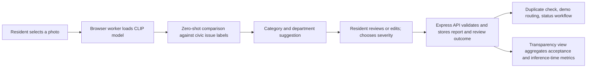

# CivicFix

> **A closer view of city life.** City updates, community, and local services — together in one place.


## About

CivicFix is a civic-services prototype for the local-government workflow of receiving, classifying, reviewing, and tracking resident reports about public infrastructure. The wider resident experience also brings city notices, events, and community information into one dashboard.

The AI-assisted reporting flow uses an open-source CLIP vision model to compare a resident-selected photo with a fixed set of civic issue descriptions. It suggests a report category and department; the resident can change them, chooses severity themselves, and submits the report to the CivicFix API. The AI does not decide authenticity, urgency, or whether municipal action is warranted.

### What works in the prototype

- Resident dashboard for civic updates, alerts, community activity, and service reports.
- In-browser, zero-shot image classification for a bounded set of infrastructure categories.
- Manual review and editing of the AI category and department before submission; severity remains a human choice.
- Report creation, status history, nearby-duplicate checks, community confirmations, messages, ratings, and demonstration crew routing.
- Transparency metrics for submitted AI suggestions, resident acceptance/edits, unclassified results, and model inference time.
- Express API with local JSON-file storage, or Supabase-backed persistence for a Vercel demo.

## Visual


*A resident-facing municipal landing page for city life, community, and services.*

## AI solution architecture



The model is [`Xenova/clip-vit-base-patch32`](https://huggingface.co/Xenova/clip-vit-base-patch32), pinned to revision `d15189d7028b43f1d3e65039190477f6af591c2a`, and run with [Transformers.js](https://huggingface.co/docs/transformers.js) and quantized ONNX inference in a web worker. Model files are downloaded from Hugging Face on first use and cached by the browser. No model API key or per-token AI charge is required. The user's photo is processed in the browser and is not sent to Hugging Face for inference. When a resident submits a report, the photo and report details are sent to CivicFix storage as described below.

CLIP's score ranks the candidate labels for that photo. It is **not** a calibrated probability, a verified confidence level, or proof that the top suggestion is correct. A weak match or a non-hazard result leads to manual selection; model failure is shown to the user and does not silently create a classification.

## Real-world use case and workflow

The workflow models a municipal service desk intake:

1. A resident photographs an issue and supplies its location and optional description.
2. Local AI offers a category and mapped department; the resident checks or changes both and selects severity.
3. The API validates and records the report, the photo, the model label/score/runtime, and whether the suggestion was accepted, edited, or unclassified.
4. The demo checks for nearby similar reports and can show a suggested crew based on static sample team data.
5. A staff-style interface demonstrates status updates and a resident can follow the ticket.

The operational integrations are illustrative. CivicFix is not connected to a municipal case-management system, real dispatch service, official location feed, or city identity provider.

## Responsible AI and data handling

- **Human oversight:** AI output is advisory. Residents can edit its classification and department; severity and final submission are human decisions. Municipal staff still need to verify reports.
- **Data minimization for inference:** the local model receives the selected image only. Location, contact details, and report description are not passed to the model.
- **Storage disclosure:** submitting a report sends its photo and details to the configured CivicFix API. Locally they are stored in JSON files. On Vercel they are stored in Supabase. The no-login demo is public and is not suitable for real or confidential resident data.
- **Bias and coverage:** CLIP is a general-purpose model, not fine-tuned or validated on local municipal photos. Lighting, camera quality, language/label wording, local infrastructure, and under-represented issue types can affect results. A model suggestion must not determine priority or deny service.
- **Transparency:** the app records whether suggestions were accepted, edited, or unclassified. Acceptance is a workflow signal, not model accuracy. A valid evaluation needs a consented, representative, human-labelled dataset and should report per-category precision/recall, false-negative rates, subgroup performance where appropriate, and review of failure cases.
- **No measured field impact yet:** the transparency view reports counts and acceptance/runtime metrics from reports that include real model assessments. Seed records are examples and are explicitly not treated as AI results; zero recorded submissions means no measured AI outcome.

## Run locally

### Requirements

- Node.js 22.12 or newer
- npm
- Internet access on first AI use to download model and runtime assets

Install dependencies:

```powershell
npm install
```

Run the API and frontend in separate terminals:

```powershell
npm run dev:api
```

```powershell
npm run dev
```

Open `http://localhost:3000`. Vite forwards `/api` requests to `http://localhost:3001`; check API health at `http://localhost:3001/api/health`.

Reports are stored in `data/reports.json` by default. Configure `API_PORT` and `REPORTS_FILE` as needed; see [`.env.example`](./.env.example). Seed data is illustrative; do not treat sample outcomes or histories as real municipal service records.

## API

Core report endpoints:

| Method | Endpoint | Purpose |
| --- | --- | --- |
| `GET` | `/api/health` | Check API availability |
| `GET` | `/api/reports` | List reports |
| `GET` | `/api/reports/:id` | Get one report |
| `POST` | `/api/reports` | Create a report; the server assigns its ID |
| `PATCH` | `/api/reports/:id/status` | Update report status |

Additional report routes support duplicate detection and per-ticket confirmations, resolutions, ratings, and messages. Civic collections are available under `/api/c/:name`.

## Deploy a demo to Vercel

Vercel function filesystems are temporary, so the deployed API requires Supabase persistence:

1. Create a Supabase project and run [`supabase/schema.sql`](./supabase/schema.sql) in its SQL Editor.
2. Import the repository into Vercel. Use the configured Vite framework, `npm run build` build command, and `dist` output directory.
3. Set `SUPABASE_URL` and `SUPABASE_SERVICE_ROLE_KEY` in Vercel Preview and Production settings. Keep the service-role key server-side; never expose it through a `VITE_` variable.
4. Deploy and verify `<deployment-url>/api/health`.

The local vision model is fetched by each resident's browser from Hugging Face; the Vercel API does not run inference. Vercel/Supabase may have hosting or storage costs even though local inference has no token-based model charges. Report images are compressed in the browser for the API request limit.

## Important limitations

**Unauthenticated demo only; not an official municipal service.** As requested, there is no sign-in or authorization. The role switcher is not access control. Public visitors can submit reports and use write-enabled endpoints, including status changes. Do not use real resident information or confidential municipal data.

- The CLIP model is zero-shot and has not been validated on a representative municipal image dataset. The label set and confidence threshold are prototype choices, not validated decision criteria.
- Local inference needs a compatible modern browser, sufficient device memory/compute, and an initial model download. If it is unavailable, users must enter the report type manually.
- Acceptance rate is not accuracy; no real-world AI quality or service-impact results are claimed.
- Local storage uses JSON files. Vercel uses a Supabase JSON-document table with revision checks, intended for a small demo rather than high-volume operations.
- The write limit is in memory per server process or function instance; it is not global abuse protection.
- Submitted photos are stored as compressed data URLs in report documents. Production use would require managed object storage, privacy controls, and retention policies.
- Classification, crew data, and sample records are demonstrative. There is no live municipal dispatch or status-feed integration.
- Before any public-service use, add appropriate authentication, authorization, shared rate limiting, monitoring, backups, privacy controls, data-retention procedures, and operational recovery processes.

## Checks

```powershell
npm run lint
npm test
npm run build
```

The tests cover AI label mapping and result validation, AI outcome metrics, API validation/persistence, and the existing report workflows. They do not measure the model's real-world classification accuracy; that requires a separately curated and labelled evaluation dataset.

## License

No license has been selected for the CivicFix application, and there is no `LICENSE` file. Reuse and redistribution of this project are therefore not granted by this README. The CLIP weights are based on OpenAI CLIP, whose upstream repository is MIT-licensed; check the [model card](https://huggingface.co/Xenova/clip-vit-base-patch32) and upstream terms before redistributing model artifacts. Third-party packages have their own licenses.

## Acknowledgments

- [React](https://react.dev/), [Vite](https://vite.dev/), and [Express](https://expressjs.com/) for the application stack.
- [Hugging Face Transformers.js](https://github.com/huggingface/transformers.js) and the [Xenova CLIP model](https://huggingface.co/Xenova/clip-vit-base-patch32) for local vision inference.
- [OpenAI CLIP](https://github.com/openai/CLIP) for the upstream model.
- [Supabase](https://supabase.com/) for optional hosted demo persistence and [Lucide](https://lucide.dev/) for interface icons.
